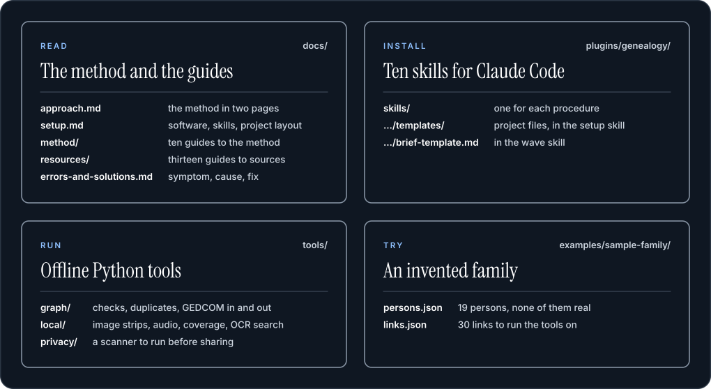
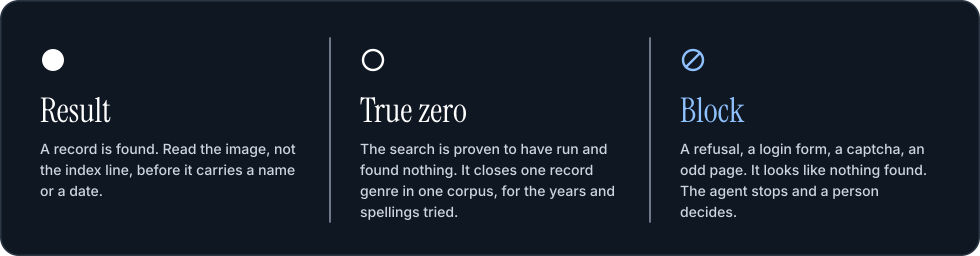
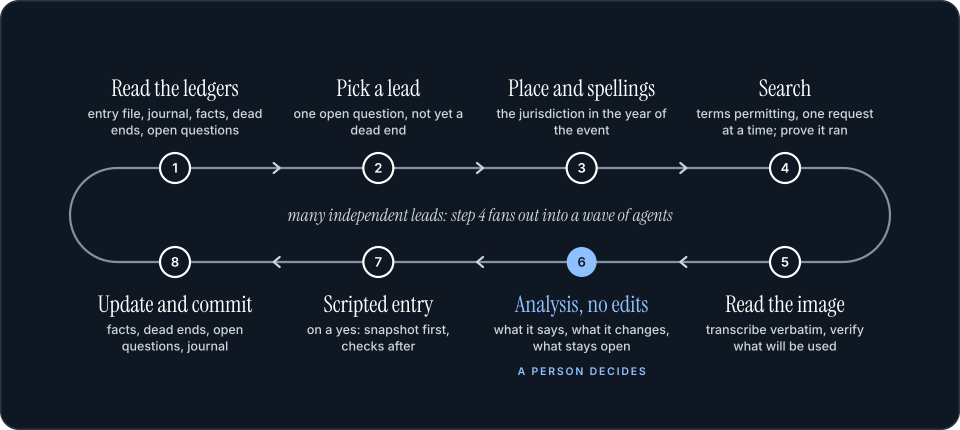
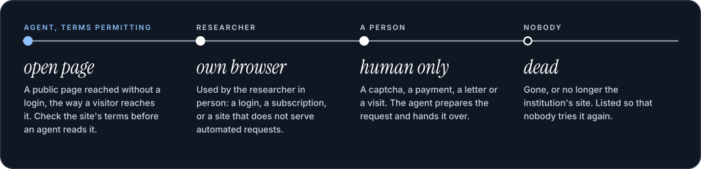

<p align="center">
  
</p>

<p align="center">
  <a href="docs/approach.md">Approach</a> ·
  <a href="docs/setup.md">Setup</a> ·
  <a href="docs/method/">Method</a> ·
  <a href="docs/resources/README.md">Resources</a> ·
  <a href="docs/errors-and-solutions.md">Errors and solutions</a> ·
  <a href="CONTRIBUTING.md">Contributing</a>
</p>

Working notes, Claude Code skills and small offline tools for family-history research with AI agents. They
come from one family's project in 2026, with ancestors in the former Russian Empire and USSR, and are shared
so that other researchers can use them, correct them and add what they have learned.

An agent is useful in this work: it reads the finding aids that archives publish, tries many spellings of one
village, transcribes a register line by line and keeps a ledger. Two of its mistakes are hard to see. An empty
answer from a site that refused the request reads like "no such person", and a record with the right name
reads like the right person. Most of the rules collected here guard against these two.

## What is here

<p align="center">
  
</p>

| Path | What it is |
|---|---|
| [`docs/approach.md`](docs/approach.md) | the method in two pages: six principles and the working loop |
| [`docs/setup.md`](docs/setup.md) | software, installing the skills, project layout, limits we ran into |
| [`docs/method/`](docs/method/) | ten guides: evidence rules, reading indexes and OCR, block versus zero, invalid zeros and false trails, transcription, the family graph and GEDCOM, incoming material, agent waves, document builds, the ledger of dead ends |
| [`docs/resources/`](docs/resources/) | thirteen guides to archives and databases, by country (Russia, Belarus, Ukraine, Estonia, Latvia, Poland, Lithuania, Czechia, Germany) and by topic (war and losses, repression, full-text archives, libraries, genealogy services), with an index: what each source holds, how it was reached, how it signals a refusal, its traps |
| [`docs/errors-and-solutions.md`](docs/errors-and-solutions.md) | a catalogue of about two hundred errors: symptom, cause, fix |
| [`plugins/genealogy/`](plugins/genealogy/) | a Claude Code plugin with ten skills, the project templates and a brief template for agent waves |
| [`tools/`](tools/) | nine offline Python tools that work on files you already have: image strips for handwriting, audio transcription, source coverage, a tolerant search over OCR text, graph checks, duplicate merging, GEDCOM in and out, a privacy scanner |
| [`examples/sample-family/`](examples/sample-family/) | an invented family of 19 persons and 30 links to run the tools on |

## Getting started

You need Claude Code and Python 3.9 or later. Clone this repository into a folder named `agentic-genealogy`,
then install the skills ([`docs/setup.md`](docs/setup.md) has the details):

```bash
claude plugin marketplace add ./agentic-genealogy
claude plugin install genealogy@agentic-genealogy
```

For one session without installing: `claude --plugin-dir ./agentic-genealogy/plugins/genealogy`.

The tools can be tried on the invented family. From the repository folder:

```bash
python3 tools/graph/check_graph.py --persons examples/sample-family/persons.json --links examples/sample-family/links.json
```

It reports 0 errors, 2 findings and 8 field states; the two findings are contradictions placed in the sample
on purpose.

To start your own project, ask Claude in an empty folder: "Set up a family-history project here". It builds
the project skeleton (an entry file, a journal, five ledgers and a folder tree) and asks for the family's own
rules, such as how living people appear. Before the first search, read
[`docs/resources/README.md`](docs/resources/README.md), the guide for your region and
[Access and responsibility](#access-and-responsibility) below.

## The main rules

<p align="center">
  
</p>

1. **A search has three outcomes: a result, a true zero and a block.** A block usually looks like a zero. A zero
   counts when the search is proven to have run, and it closes one record genre in one corpus under the
   spellings tried. [`block-vs-zero.md`](docs/method/block-vs-zero.md),
   [`invalid-zeros-and-false-trails.md`](docs/method/invalid-zeros-and-false-trails.md)
2. **A name is not an identifier.** The same given name, patronymic and surname recur in one village. Identity
   needs a document, or household, parish and confession agreeing; until then two records stay two persons
   with a weak link. [`evidence-rules.md`](docs/method/evidence-rules.md)
3. **The files are the memory.** Sessions and agents share only the project folder. An entry file, a journal
   and five ledgers (facts, dead ends, open questions, sources, know-how) hold the state. A session reads the
   entry file, the journal, the dead ends and the open questions before it searches, and writes all of them as
   the work goes. [`approach.md`](docs/approach.md), [`dead-ends.md`](docs/method/dead-ends.md)
4. **The agent prepares, a person decides.** A new document gets an analysis that changes nothing and ends with
   the question "enter it?". What is said about the living, what is published and what is sent to a stranger
   are a person's decisions. [`incoming-material.md`](docs/method/incoming-material.md)

An example with invented names. The question is the baptism of Ivan Primerov, born about 1874 in the village
of Primerovka. An answer in the shape these rules ask for:

> **Before searching.** The ledger of dead ends already holds a closed search for this parish, 1870-1880,
> under two spellings. Three spellings are new: Примеров, Примерав, Primerow.
>
> **First source: result.** One entry in 1874, read from the image. The name and the year fit, but the entry
> names a father we have no document for, so this is not yet proven to be our Ivan.
>
> **Second source: true zero.** The control query returned records, so the search ran. This closes baptisms
> for 1870-1880 in this one index under these three spellings.
>
> **Third source: block.** A login form in place of a result list. It goes on the researcher's list, for their
> own browser.
>
> **Nothing has been changed.** Enter the 1874 entry as a separate person, with a possible link to our Ivan?

## How the work runs

<p align="center">
  
</p>

Every session reads the ledgers before it searches and writes them as it goes. The agent prepares the analysis
and asks; what a document changes in the family record is decided by a person (step 6). An accepted entry is
made by a script, with a snapshot before it and checks after it. When many independent leads exist, the search
step fans out into a wave of agents, each with its own site and its own report file. The loop is described in
[`docs/approach.md`](docs/approach.md).

## Who can reach a source

<p align="center">
  
</p>

Sites in the resource guides carry one of these four classes, or a dated note where a site gave no answer.
A class records how a site was reached in 2026. What the site's terms of use allow is for you to check before
an agent reads anything (see [Access and responsibility](#access-and-responsibility)).

## Skills and guides

Each procedure is a skill that Claude loads when its situation arises, and a guide that explains why the
rule exists.

| When | Skill | Guide |
|---|---|---|
| starting a project | `setting-up-a-project` | [`setup.md`](docs/setup.md) |
| beginning, resuming or closing a session | `starting-a-research-session` | [`approach.md`](docs/approach.md), [`dead-ends.md`](docs/method/dead-ends.md) |
| searching a database, a catalogue or an index | `searching-a-source` | [`block-vs-zero.md`](docs/method/block-vs-zero.md), [`reading-indexes-and-ocr.md`](docs/method/reading-indexes-and-ocr.md) |
| deciding whether two records are one person | `identifying-people` | [`evidence-rules.md`](docs/method/evidence-rules.md) |
| reading a handwritten record or a recording | `reading-old-records` | [`transcription.md`](docs/method/transcription.md) |
| a new document or a relative's statement arrives | `taking-in-new-material` | [`incoming-material.md`](docs/method/incoming-material.md) |
| changing the family graph, importing or exporting GEDCOM | `maintaining-the-family-graph` | [`family-graph-and-gedcom.md`](docs/method/family-graph-and-gedcom.md) |
| sending several agents out in parallel | `running-a-research-wave` | [`agent-waves.md`](docs/method/agent-waves.md) |
| writing to an archive or to a person | `writing-to-archives-and-people` | [`needs-a-human.md`](docs/resources/needs-a-human.md) |
| before anything leaves the private project | `checking-privacy-before-sharing` | [`tools/privacy/`](tools/privacy/) |
| building a book or a report from the project | | [`document-builds.md`](docs/method/document-builds.md) |

## What stays with the researcher

- **Logins, captchas and paywalls.** These steps go on a list for a person, with a clear hand-over.
- **Who an ancestor is.** The agent lays out the evidence and says what is proven and what is open.
- **Letters to relatives.** The researcher writes them, in their own words and saying that AI helped; the
  agent supplies the facts and the questions.
- **Each site's terms of use.** They are checked site by site before an agent reads anything.
- **What is published.** What is said about the living and what leaves the project are a person's decisions.

## Contributing

These notes describe sites as they were seen from one network in 2026, and they cover the regions one family
needed. They get better with other people's observations. What helps most:

- a dated correction to a site's behaviour: it moved, closed, changed its refusal page, added an index;
- a guide for a region or an archive that is missing, in the same shape as the existing ones;
- an error you ran into, as a row for the catalogue: symptom, cause, fix.

The rules are in [`CONTRIBUTING.md`](CONTRIBUTING.md): invented names in examples, issues and pull requests;
what a visitor sees on public pages and the official routes; observations with a month and a year.

## Access and responsibility

Where a site's terms of use and robots rules allow it, an agent may read its public pages the way a visitor
does: one site at a time, one request at a time, slowly, stopping at the first refusal and never retrying in
a loop. Checking those terms, and the law that applies to you, is your responsibility; when in doubt, use
the site yourself in your browser.

Anything behind a login, a subscription or a captcha is used by the researcher personally, in their own
browser. The guides describe what a visitor sees on public pages and the official routes: a written request,
a library copy, a visit. Where a site refuses, the agent stops and the step passes to a person.

A conversation with a relative is recorded only with the knowledge and consent of everyone who speaks in
it. Before anything about living people leaves the private project, read the privacy skill named below.

## Good to know

**The examples are invented.** They are composed illustrations: the patterns come from real work, and every
surname, village and shelf mark in them is invented (the Primerov and Obraztsov families, the village of
Primerovka, the Näidis and Paraugs families). Any resemblance to real persons is coincidental.

**Sites change.** Every statement about a site's behaviour is a dated observation from 2026, with the month
where the notes give one; for a site that gave no answer the guides give the official alternative. Treat the
guides as a starting point, record your own dated observations in your project's `SOURCES.md`, and trust yours
over ours.

**Privacy.** If you publish anything derived from your own research, read
[`checking-privacy-before-sharing`](plugins/genealogy/skills/checking-privacy-before-sharing/SKILL.md)
first. This repository was prepared that way: examples written with an invented cast, and a deny-list
built from the private data scanned against every file before publication.

**Disclaimer.** This is an independent, unofficial project. The names and trademarks of the services and
institutions it mentions belong to their owners. The material is provided as it is; the full terms are in
[`DISCLAIMER.md`](DISCLAIMER.md).

**Corrections and removal.** If you represent an institution, or you are a person affected by something
written here, and you want a statement corrected or removed, open an issue in this repository and name the
file and the passage. Every request is reviewed, and a passage that is inaccurate or a mention that is not
wanted is corrected or removed. Keep personal data out of the issue itself; if the request needs it, say so in
the issue and a private channel will be arranged.

**Licence.** Everything under `tools/` and `examples/` (code, its README files, the schema) is under the MIT
licence, see [`LICENSE`](LICENSE). Everything else (`docs/`, the skills and templates in `plugins/`, the
graphics in `assets/`, this file) is under Creative Commons Attribution 4.0, see
[`LICENSE-docs`](LICENSE-docs). The project templates may be copied into your own project without attribution.
